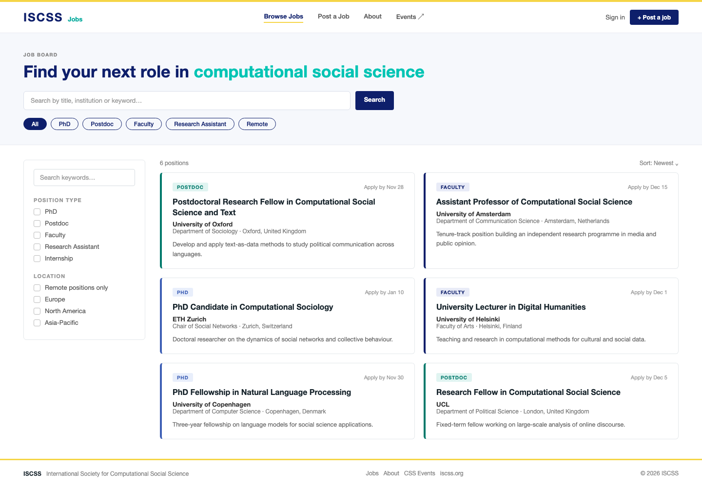

# Branding and design

How CSS Jobs looks, and the exact values behind it. Part of the
[CSS Jobs documentation](../README.md#documentation). The sister site, [CSS Events](https://events.iscss.org),
uses the same palette and header style; change them together.

- [Name and wordmark](#name-and-wordmark)
- [Colours](#colours)
- [Typography](#typography)
- [Layout and components](#layout-and-components)
- [Badges and status colours](#badges-and-status-colours)
- [Logo, icons and share image](#logo-icons-and-share-image)
- [The design reference](#the-design-reference)
- [Accessibility](#accessibility)
- [Voice](#voice)
- [Where it lives in the code](#where-it-lives-in-the-code)

---

## Name and wordmark

| | |
|---|---|
| **Organisation** | ISCSS, the International Society for Computational Social Science |
| **Site name** | CSS Jobs ("ISCSS Jobs" in the header and share cards) |
| **Page title** | `CSS Jobs - Academic Opportunities in Computational Social Science` |
| **Description** | `Find and post academic opportunities in computational social science - PhDs, postdocs, faculty positions, and research collaborations.` |
| **Address** | https://jobs.iscss.org |

The header wordmark is **text, not an image**: `ISCSS` in Inter Black, 24px, letter-spacing
0.08em, in navy; beside it a small `Jobs` tag in teal `#00a99b`, 13px semibold, hidden below
the `sm` breakpoint. The footer repeats `ISCSS` (bold, 14px, wide tracking) followed by
"International Society for Computational Social Science".

---

## Colours

The ISCSS palette is defined once as CSS variables in `src/index.css` and exposed as
Tailwind `brand-*` colours in `tailwind.config.ts`. It is shared with events.iscss.org.

| Name | Hex | HSL variable | Tailwind | Used for |
|------|-----|--------------|----------|----------|
| **Navy** | `#0e1f6b` | `--brand-navy` `229 77% 24%` | `brand-navy` | Wordmark, headings, primary buttons, filter chips (selected), links, focus ring. The primary colour |
| **Gold** | `#f5d547` | `--brand-gold` `49 90% 62%` | `brand-gold` | The 4px strip across the top of the header. A signature accent, never used for text |
| **Teal** | `#00c4b4` | `--brand-teal` `175 100% 38%` | `brand-teal` | The highlighted phrase in the page headline. Decorative; too light for small text |
| **Teal dark** | `#00796b` | `--brand-teal-dark` `174 100% 24%` | `brand-teal-dark` | Teal where text must be readable: the Postdoc stripe and tag (`#00796b`), and white-on-teal badges. Hover colour for teal buttons |
| **Teal tint** | `#e0f8f6` | `--brand-teal-tint` `174 63% 93%` | `brand-teal-tint` | Light teal backgrounds |
| **Surface** | `#f4f6fb` | `--brand-surface` `222 46% 97%` | `brand-surface` | The hero band and soft panels |
| **Surface 2** | `#e8ecf7` | `--brand-surface-2` `226 50% 94%` | `brand-surface-2` | Hover states, subtle badges, loading skeletons |
| **White** | `#ffffff` | `--background` | `background` | Page, header, cards, footer |

The header's "Jobs" tag uses `#00a99b`, a teal between **Teal** and **Teal dark**. It is
set directly in `Header.tsx` and is not one of the variables.

### Neutrals

| Use | Value |
|-----|-------|
| Body text | `#333333` (`--foreground` `0 0% 20%`) |
| Secondary text | `#545454` (`--muted-foreground`), and the greys `#555`, `#666`, `#777` in cards and footers |
| Card title | `#16232b` |
| Meta text (dates, counts) | `#888`, `#999` (see [Accessibility](#accessibility)) |
| Borders | `#e8eaf0` (header, hero), `#e3e7ea` (cards), `#d9deea` (inputs); default `--border` `220 13% 91%` |
| Destructive | `--destructive` `0 84.2% 60.2%` (about `#ef4444`) |

### Gradients

The old purple gradients were replaced with flat navy: `--gradient-primary`,
`--gradient-featured` and `--gradient-button` are all navy to navy, so any leftover
`.modern-gradient` or `.featured-gradient` still comes out on brand. `--gradient-accent`
runs navy to teal. The shared `Button` component's default variant paints one of these
gradients as a background *image*, which hides any background colour set on top of it.
That is why the header buttons are plain `<button>` elements.

### Dark mode

A `.dark` palette exists in `src/index.css` (the shadcn/ui default) but **nothing switches it
on and it has not been branded**. Treat the site as light-only.

---

## Typography

| | Value |
|---|---|
| **Interface font** | **Inter**, weights 300, 400, 500, 600, 700 (Tailwind `font-sans`, with `system-ui, sans-serif` as the fallback) |
| **Serif** | **Crimson Text**, weights 400 and 600 (Tailwind `font-serif`). Only used by the old home-page hero, which is no longer routed, so it is effectively unused |
| **Loaded from** | Google Fonts, through an `@import` at the top of `src/index.css` |

### Scale in use

| Element | Style |
|---------|-------|
| Page headline | 34px, extrabold (800), navy, with the key phrase in teal. `text-3xl md:text-[34px]` |
| Wordmark | 24px, black (900), letter-spacing 0.08em, navy |
| Card title | 16px, bold, `#16232b`, turns navy on hover |
| Institution (card) | 13px, semibold, `#333` |
| Place and summary (card) | 12px to 12.5px, `#777` and `#666` |
| Eyebrow label ("JOB BOARD") | 10px, bold, uppercase, letter-spacing 0.12em, `#888` |
| Buttons and inputs | 12px to 13px, semibold or regular |
| Type tag and small labels | 11px, bold, uppercase |

### Fonts and the Content-Security-Policy

Google Fonts only loads if **both** security policies allow it. The site sends one in the
`vercel.json` headers and another as a `<meta>` tag in `index.html`, and browsers enforce
the stricter of the two. Until 2026-11-06 the `<meta>` policy did not allow
`fonts.googleapis.com` or `fonts.gstatic.com`, so **Inter and Crimson Text were blocked and the
site fell back to the browser's default font**. The two policies now match. If fonts ever stop
loading, check that both policies still allow those two hosts. Self-hosting the fonts (for
example with the `@fontsource` packages) would remove the dependency and the third-party
request.

---

## Layout and components

| Part | Specification |
|------|---------------|
| **Page width** | Content centred at a maximum of 1440px, with 24px side padding (48px from the `md` breakpoint) |
| **Header** | Sticky, white, 1px bottom border `#e8eaf0`. A 4px gold strip on top, then a 64px bar: wordmark left, **Post a job** and the account menu right. A menu button replaces them on mobile |
| **Hero** | Surface `#f4f6fb` band with a bottom border. Eyebrow label, headline, search box with a navy **Search** button, then filter chips |
| **List area** | A filter sidebar on the left and a two-column grid of job cards on the right |
| **Job card** | White, 1px `#e3e7ea` border, **4px left stripe coloured by job type**, 6px radius, 22px by 20px padding. Hover adds a shadow and a slightly darker border. Contents: type tag, "Apply by" date, title, institution, place, two-line summary, a save button |
| **Filter chips** | Pill shape (`rounded-full`), 1px navy border, 12px text. Selected: navy fill with white text. Unselected: transparent, with the Surface 2 tint on hover |
| **Primary button** | Navy fill, white 12px to 13px semibold text, 4px radius, hover at 90% navy. The same style is used for **Post a job** and **Search** |
| **Footer** | White with a top border: `ISCSS` and the full name on the left, links (Jobs, CSS Events, iscss.org) in the middle, the copyright on the right |
| **Radius** | Components from shadcn/ui use `--radius` `0.75rem`; the custom list and header pieces use 4px to 6px |

Components come from **shadcn/ui on Radix UI**, styled with Tailwind, in `src/components/ui/`.
The custom list, header and card styling lives with the pages that use it (`Header.tsx`,
`Jobs.tsx`, `CompactJobCard.tsx`) rather than in the shared components.

---

## Badges and status colours

### Job type (the card stripe and tag)

| Type | Stripe | Tag background and text |
|------|--------|-------------------------|
| Postdoc | `#00796b` | `#e0f4f1` on `#00796b` |
| Faculty | navy `#0e1f6b` | `#e8ebf7` on navy |
| PhD | `#3d5fb5` | `#e8eefb` on `#3d5fb5` |
| Research Assistant | slate `#64748b` | slate-100 on slate-600 |
| Internship | amber `#f59e0b` | amber-50 on amber-700 |
| Other | slate `#94a3b8` | slate-100 on slate-600 |

### Approval and account status (admin and profile screens)

| Meaning | Colours |
|---------|---------|
| Approved | green-100 background, green-800 text |
| Pending | yellow-100 background, yellow-800 text (amber for "awaiting approval") |
| Rejected | red-100 background, red-800 text |
| Admin | navy background, white text |
| Job poster | green-100 on green-800 |
| Member | Surface 2 background, navy text |

Role names and rules are in [HANDBOOK > Roles](HANDBOOK.md#roles-and-permissions).

---

## Logo, icons and share image

| Asset | File | Notes |
|-------|------|-------|
| ISCSS logo | `public/sponsors/ISCSS-Logo.png` | 523 by 159 px. Used as the **share image**, and in the old home-page section that is no longer routed |
| Other logos | `public/sponsors/IC2S2-Logo-White.png`, `ICWSM-2025.png` | Partner and conference logos |
| Favicon | `public/favicon.ico` | |
| Placeholder | `public/placeholder.svg` | Not part of the brand |

**Share cards** (`og:*` and `twitter:*` in `index.html`) use the ISCSS logo, the page title and
description, `og:site_name` "ISCSS Jobs" and the address https://jobs.iscss.org. Until
2026-11-06 they pointed at a placeholder image from the site-builder used to scaffold the
project. A proper share image (1200 by 630 px, wordmark plus headline) would look better
than a small logo; the card type is `summary` for that reason. `twitter:site` is set to
`@cssjobs`, which has not been confirmed to be an ISCSS account.

---

## The design reference

The look follows **mockup B, "light, tied to events"**: a white header with the gold strip
and navy wordmark, a pale hero with a navy and teal headline, filter chips, and cards with a
coloured left stripe. Mockup A (the classic ISCSS look) and C (a split list-and-detail
view) were the alternatives and are not used.

Files: [`design/B-light-events-tie.png`](design/B-light-events-tie.png) and the source
[`design/B-light-events-tie.html`](design/B-light-events-tie.html).

Where the build differs from the mockup:

- The mockup uses Helvetica Neue; the site uses Inter.
- The mockup's header has centre navigation (Browse Jobs, Post a Job, About, Events); the site has no
  centre navigation (the page is the jobs list) and shows **Post a job** and the account menu on the right.
- The mockup's footer has a gold top rule; the site's footer has a plain grey border.

---

## Accessibility

Contrast ratios measured against WCAG 2.1 (AA needs 4.5:1 for normal text, 3:1 for large text).

**Passing:** navy on white 14.7:1; body text `#333` on white 12.6:1; secondary `#545454` 7.6:1;
white on navy 14.7:1; gold and navy against each other 10.2:1; Teal dark on white 5.3:1; every
job-type tag and status badge in the tables above (4.7:1 to 12.4:1).

**Failing, and what to do about each:**

| Where | Colours | Ratio | Fix |
|-------|---------|-------|-----|
| Headline highlight "computational social science" | Teal `#00c4b4` on Surface `#f4f6fb` | 2.0:1 (needs 3:1 even as large text) | Use Teal dark `#00796b` (4.9:1), or keep teal only as a decorative underline |
| The "Jobs" tag in the header | `#00a99b` on white | 2.9:1 | Use Teal dark `#00796b` |
| "Apply by" dates on cards | `#999` on white | 2.9:1 | Use `#666` or darker |
| Footer copyright | `#aaa` on white | 2.3:1 | Use `#666` |
| Place line on cards, footer tagline | `#777` / `#888` on white | 4.5:1 / 3.5:1 | `#777` is borderline; use `#666` |

These are cosmetic changes in `Header.tsx`, `Jobs.tsx`, `CompactJobCard.tsx` and `Footer.tsx`;
none has been made, so the contrast above describes the site as it is today.

Other points: every icon-only button should keep its `aria-label` (the mobile menu button
has one); links are underlined or change colour on hover; focus rings use navy.

---

## Voice

Plain and direct, written for researchers rather than recruiters. Short sentences, no
jargon, no exclamation marks. Examples used on the site: the headline "Find your next role
in computational social science", the button "Post a job", "Apply by Nov 28", and
"You do not need an account to browse or apply for jobs". Say **member** for an account with
no posting rights (not "job seeker"), and **admin** and **job poster** for the other two roles.

---

## Where it lives in the code

| What | File |
|------|------|
| Colour variables, fonts, gradients, utility classes | `src/index.css` |
| `brand-*` Tailwind colours, font families | `tailwind.config.ts` |
| Header and wordmark | `src/components/layout/Header.tsx` |
| Footer | `src/components/layout/Footer.tsx` |
| Hero, search and filter chips | `src/pages/Jobs.tsx` |
| Job card, type stripes and tags | `src/components/jobs/CompactJobCard.tsx` |
| Role names and badge colours | `src/lib/roles.ts` |
| Page title, description, share cards, security policy | `index.html` and `vercel.json` |
| Shared UI components | `src/components/ui/` (shadcn/ui) |
